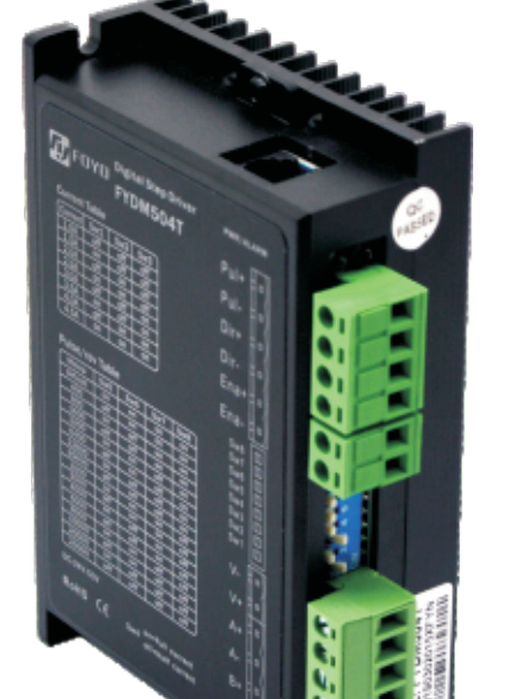

# DM Series Two-Phase Stepper Driver — FYDM504T

> English translation of the XFOYO (兴丰元) FYDM504T datasheet, printed from
> <https://www.xfoyo.com/a/bujinqudong/liangxiangbujinqudongqi/417.html>
> Source PDF: `FYDM504T_兴丰元_触摸屏_PLC_步进电机_驱动器_...pdf` (4 pages).
> The original datasheet is a single image; it was OCR'd/cropped at native
> resolution (2566×4102 px) and translated. Section order and both-column
> layout follow the original. See `FYDM504T_datasheet_EN.html` for a
> page-layout replica with redrawn diagrams.

---

## Product Overview

| Model | Voltage | Drive current | Microstepping | Max. pulse frequency |
|---|---|---|---|---|
| FYDM504T | DC24~50V<br>AC20~40V | 1.0 ~ 4.5 A/phase<br>8 settings, adjustable | Max. resolution 25600 steps/rev<br>16 settings, adjustable | 250 Kpps |

## Product Features

- **High performance, high efficiency:** latest 32-bit DSP control technology, so the motor delivers its best output performance.
- **Low vibration, low noise:** automatically calculates the resonance point, effectively suppressing motor noise and vibration when running at low speed.
- **Small temperature rise, long service life:** precision current control keeps the motor temperature rise low.
- **Wide speed range:** with a suitable stepper motor, up to 1500 rpm.
- **Interference-frequency filtering:** optically isolated differential signal input; pulse response frequency up to 250 Kpps.
- **Powerful, low repair rate:** imported industrial-grade components, mature and stable technology; fault-status indication and automatic protection for undervoltage, overvoltage, overcurrent, short circuit, open circuit and wrong phase, etc.
- **Compatible stepper motors:** 56, 60, 86 mm series.

## Application Fields

Suitable for automation equipment and instruments in every kind of motion-control field, for example:
electronic machining and inspection, semiconductor packaging, laser cutting and welding, laser
phototypesetting, packaging machinery, engraving machines, marking machines, cutting machines,
garment plotters, CNC machine tools, automated assembly equipment, etc. It is the first choice for
users in fields where low noise, superior high-speed performance and strong price/performance
competitiveness are expected.

## Product Mounting Dimensions

Units: mm. See the side and front views in the HTML version; the original drawing is dimensioned as:

| View | Dimensions |
|---|---|
| Side view | body width 34, mounting-notch/heat-sink edge 4.5, height 112, bottom notch inset 10.5 |
| Front view | mounting-hole pitch 48 and 25.3, height 118 (overall, including the heat-sink tab) / 112, mounting holes 4-Φ4, width 75.5 |



## Driver Wiring Diagram

```
   Signal LED (green) ─────────────┐
   Fault  LED (red)   ─────────────┘   ○ ○
                                        ┌─────────┐
   Pulse signal +      ──────────────  Pul+   ┤:┤
   Pulse signal −      ──────────────  Pul−   ┤:┤
   Direction signal +  ──────────────  Dir+   ┤:┤
   Direction signal −  ──────────────  Dir−   ┤:┤
   Motor enable sig. + ──────────────  Ena+   ┤:┤
   Motor enable sig. − ──────────────  Ena−   ┤:┤
                                        └─────────┘
   Microstep setting   ──────┬────────  SW8 ┐
                              │          SW7 │  ┌───────┐
                              ├────────  SW6 ├──┤8 7 6 5│
                              │          SW5 │  │4 3 2 1│
   Holding-current sel. ──────┼────────  SW4 │  └───────┘
                              │          SW3 │
   Current setting     ──────┴────────  SW2 │
                                        SW1 ┘
                                        ┌─────────┐
   DC24–50V            ──────────────  V−     ┤:┤
   AC20~40V            ──────────────  V+     ┤:┤
   ┌──────────────┐                     A+     ┤:┤
   │  Motor       ├──────────────────  A−     ┤:┤
   │  A phase     ├──────────────────  B+     ┤:┤
   │  B phase     ├──────────────────  B−     ┤:┤
   └──────────────┘                     └─────────┘

   ┌─────────────────┐
   │ Communication   │        (RJ-type connector on the underside of the housing)
   │ port            │
   └─────────────────┘
```

## Indicator and Pin Function Description

| Marking | Name | Notes |
|---|---|---|
| PWR | Power indicator LED | Lights green when powered on. |
| ALARM | Overcurrent / undervoltage indicator LED | Lights red when the current is too high or the voltage is too low. |
| PUL+ | Pulse signal, positive terminal | Connect to the signal supply; +5 V to +24 V will all drive it. |
| PUL− | Pulse signal, negative terminal | Falling edge is active — the motor takes one step each time the pulse goes from high to low. Input resistance 220 Ω; requirements: low level 0 to 0.5 V, high level 4 to 5 V, pulse width > 2.5 µs. |
| DIR+ | Direction signal, positive terminal | Connect to the signal supply; +5 V to +24 V will all drive it. |
| DIR− | Direction signal, negative terminal | Used to change the motor's direction of rotation. Input resistance 220 Ω; requirements: low level 0 to 0.5 V, high level 4 to 5 V, pulse width > 2.5 µs. |
| ENA+ | Enable signal, positive terminal | Connect to the signal supply; +5 V to +24 V will all drive it. |
| ENA− | Enable signal, negative terminal | When active (low level) it cuts off the motor coil current, the driver stops working and the motor is in a free state. |
| V− | Power supply, negative pole | DC24 V ~ 50 V / AC20 ~ 40 V |
| V+ | Power supply, positive pole | DC24 V ~ 50 V / AC20 ~ 40 V |
| A− A+<br>B+ B− | Motor wiring | 4-lead, 6-lead, 8-lead (for high speed), 8-lead (for low speed) — see the four winding diagrams below. |

**Motor wiring options** (as drawn in the original):

| Option | Connection |
|---|---|
| 4-lead (四出线) | A+/A− to one phase, B+/B− to the other phase. |
| 6-lead (六出线) | A+ / (unconnected) / A− and B+ / (unconnected) / B− — the centre taps are left unconnected. |
| 8-lead, for high speed (八出线, 适用高速) | Windings connected in parallel. |
| 8-lead, for low speed (八出线, 适用低速) | Windings connected in series. |

## Running Current Setting

| Peak current | SW1 | SW2 | SW3 |
|---|---|---|---|
| 1.0 A | off | off | off |
| 1.5 A | on | off | off |
| 2.0 A | off | on | off |
| 2.5 A | on | on | off |
| 3.0 A | off | off | on |
| 3.5 A | on | off | on |
| 4.0 A | off | on | on |
| 4.5 A | on | on | on |

## Microstep Subdivision Setting

| Pulses/rev | SW5 | SW6 | SW7 | SW8 |
|---|---|---|---|---|
| default | on | on | on | on |
| 400 | off | on | on | on |
| 800 | on | off | on | on |
| 1600 | off | off | on | on |
| 3200 | on | on | off | on |
| 6400 | off | on | off | on |
| 12800 | on | off | off | on |
| 25600 | off | off | off | on |
| 1000 | on | on | on | off |
| 2000 | off | on | on | off |
| 4000 | on | off | on | off |
| 5000 | off | off | on | off |
| 8000 | on | on | off | off |
| 10000 | off | on | off | off |
| 20000 | on | off | off | off |
| 25000 | off | off | off | off |

## Input Signal Waveform Timing Diagram

```
  PUL ────┐    ┌────┐   ┌──┐                    ┌──┐   ┌──┐    ┌──────
          └────┘    └───┘  └────────────────────┘  └───┘  └────┘
           ├ T3 ┤   ├ T4 ┤  ├──── T2 > 1µs ─────┤

  DIR ─────┐                                           ┌──────────────
           └───────────────────────────────────────────┘

  ENA ───────┐
             └───────────────────────────────────────────────────────
             ↑ T1 (> 5µs) is marked at the start of the pulse train
```

| Symbol / annotation | Value as printed | Where it is drawn |
|---|---|---|
| T1 | > 5 µs | at the start of the pulse train (dashed line through the PUL/DIR/ENA rows) |
| T2 | > 1 µs | spanning a high-level interval of PUL |
| T3 | not specified | bracketing a narrow PUL pulse |
| T4 | not specified | bracketing a narrow PUL pulse |
| High level | above 3.5 V | annotated on the PUL and DIR high levels |
| Low level | below 0.5 V | annotated on the PUL, DIR and ENA low levels |

The original diagram defines only T1 (> 5 µs) and T2 (> 1 µs) numerically; T3 and T4
mark pulse-width intervals that the datasheet leaves unlabelled. No meaning is stated
for any of them beyond the values above.

See `FYDM504T_datasheet_EN.html` for a redrawn version of this diagram.

## Notes (注意)

1. The input voltage must not exceed DC50 V / AC40 V. When the driver is powered up, the green PWR indicator lights.
2. If the driver's fault indicator lights, check the motor wiring and the control signal lines. If it is a motor-wiring or other short-circuit fault, it must be powered off and on again to recover after the fault is cleared.
3. SW4 sets the holding-current function: **ON = Full Current**, **OFF = Half Current**. SW4 is set to OFF at the factory, which reduces heat generation in the motor and driver and improves reliability. The current is automatically reduced by 50 % 100 ms after the pulse train stops.
4. This driver has a single/double pulse selection function, settable through the communication port; the factory default is **pulse + direction**.

---

## Site page furniture (not part of the datasheet)

| Original | Translation |
|---|---|
| 主页 > 步进驱动 > 两相步进驱动器 | Home > Stepper Drives > Two-Phase Stepper Drivers |
| (点此跳转到淘宝购买) | (Click here to jump to Taobao to buy) |
| 产品描述 | Product description |
| 上一篇：FYDM402T | Previous: FYDM402T |
| 下一篇：已停产FYDM506T2 | Next: FYDM506T2 (discontinued) |
| 相关产品推荐 | Recommended related products |
| 友情链接 | Friendly links |
| 兴丰元-阿里国际店 / 阿里中文店 / 淘宝企业店 / 淘宝个人店 / 英文官网 | XFOYO – Alibaba International Store / Alibaba Chinese Store / Taobao Enterprise Store / Taobao Personal Store / English official website |
| 总机：0755-27369350 | Switchboard: 0755-27369350 |
| 电话：13662209061 (刘小姐) | Phone: 13662209061 (Ms. Liu) |
| 邮箱：sales@xfoyo.com | Email: sales@xfoyo.com |
| 地址：深圳市宝安区西乡街道航城工业区河东工业园D栋 | Address: Building D, Hedong Industrial Park, Hangcheng Industrial Zone, Xixiang Street, Bao'an District, Shenzhen |
| 版权所有 © 深圳市兴丰元机电有限公司 | Copyright © Shenzhen XFOYO Electromechanical Co., Ltd. |
| 备案号：粤ICP备06058014号-4 | ICP filing: 粤ICP备06058014号-4 |

---

## Translation notes / caveats

- Page 2 of the PDF is **blank** (a print artifact — the page images failed to render); it contains no data.
- The datasheet says the compatible motors are the **56, 60, 86 mm** series. 56 mm is what is printed; the industry-standard frame size is 57 mm (NEMA 23), so this looks like a typo in the original. 86 mm = NEMA 34.
- The original writes the peak current as *"1.0 ~ 4.5 A/phase"* in the overview but *"drive current"*; the setting table is per-phase peak current.
- "Pulses/rev" (脉冲/圈) is the driver's microstep resolution setting; the "default" row (all on) is the factory setting.
- Terminology: 细分 = microstepping/subdivision; 锁机电流 = holding (standstill locking) current; 脉冲/圈 = pulses per revolution.
